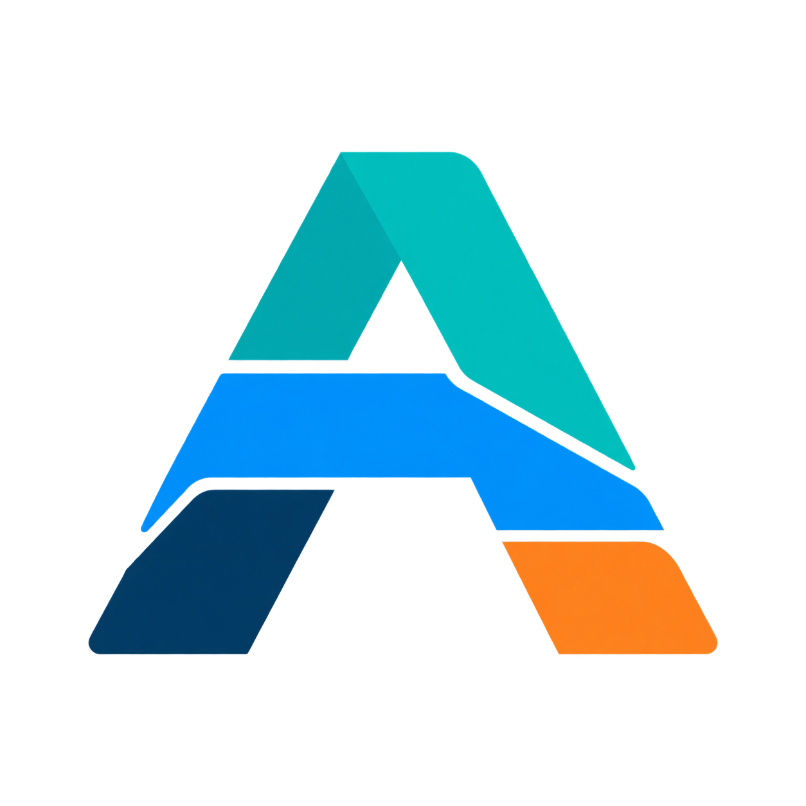

<p align="center">
  
</p>

# AStack

Workflows for Claude Code and Codex, adapted from [Lauren Tan's PStack](https://github.com/cursor/plugins/tree/main/pstack).

AStack gives your coding agent reusable skills for planning changes, fixing bugs, reviewing code, and verifying results. Start with `auto` to select a workflow for your task, or invoke a specific skill.

[Install](#install) · [Get started](#get-started) · [Skill catalog](docs/reference.md) · [Contributing](CONTRIBUTING.md)

## Install

### Claude Code

Run in Claude Code:

```text
/plugin marketplace add aataraxiaa/astack
/plugin install astack@astack
```

Follow the install prompts, then start a new session. Run `/astack:setup-astack` to choose models available in your account and configure automatic routing.

### Codex

Run in a terminal:

```sh
codex plugin marketplace add aataraxiaa/astack
codex plugin add astack@astack
```

Start a new Codex session and ask:

```text
Use AStack's setup-astack skill to configure my models and automatic routing.
```

If `codex plugin` is unavailable, update your Codex CLI to a version with plugin support.

Both installations use the same skills. Review any hook trust prompt during installation. If you already use PStack, disable its routing hook before enabling AStack's. You do not need separate copies of the skills in your personal skills directory.

See the [Claude Code installation guide](https://code.claude.com/docs/en/discover-plugins) for installation scopes and plugin management.

## Get started

In Claude Code, include the workflow command with your request:

```text
/astack:auto Add pagination to the search results.
```

In Codex, request the installed skill by name:

```text
Use AStack's auto skill to add pagination to the search results.
```

For a specific task, choose a skill directly:

| Task | Skill |
| --- | --- |
| Choose a workflow or get setup help | `auto-help` |
| Understand existing code | `how` |
| Plan types and module structure | `architect` |
| Fix a bug with a failing test first | `tdd` |
| Review a change with multiple models | `interrogate` |
| Diagnose failing PR checks | `fix-ci` |

Claude Code uses `/astack:<skill>`. In Codex, ask for the skill by name. The [full catalog](docs/reference.md) covers configuration, dependencies, and all available skills.

Some workflows need additional tools. Bundled scripts require [Bun](https://bun.sh), GitHub workflows require authenticated [GitHub CLI](https://cli.github.com/), and some stacked-PR workflows use [Graphite](https://graphite.dev/). AStack does not install these tools for you.

## Contribute

From a local checkout, generate the plugin files and run the checks:

```sh
bun tools/generate.mjs
bash tools/check.sh
```

To try the local plugin in Claude Code, run `claude --plugin-dir "$PWD/plugins/astack"` from the repository root.

See [CONTRIBUTING.md](CONTRIBUTING.md) for development checks and [runtime acceptance](docs/runtime-acceptance.md) for testing installed plugins.

AStack tracks original PStack through its [upstream update workflow](docs/upstream.md). Maintainers can configure [scheduled updates](docs/maintenance.md) separately. Installing the plugin does not enable a scheduler.

## Data handling

AStack adds no server or telemetry. Agent-visible source and transcripts are processed by the selected harness and model provider. Bundled scripts execute locally; PR workflows use the user's GitHub credentials. A workflow does not grant permission to publish or send messages.

## Credits and license

AStack builds on [Lauren Tan's original PStack](https://github.com/cursor/plugins/tree/main/pstack) and the Claude Code and Codex portability work in [Michael Denyer's pstack-claude](https://github.com/michael-denyer/pstack-claude). Ongoing updates come directly from original PStack. Exact revisions and adaptation ownership are recorded in [upstream pins](tools/upstream.json), [provenance](tools/provenance.json), and [adaptations](docs/adaptations.md).

MIT. Original PStack is by Lauren Tan; portability work is by Michael Denyer; imported cursor-team-kit material is by Cursor. Copyright and license notices are retained in [LICENSE](LICENSE), [LICENSE-cursor-team-kit](LICENSE-cursor-team-kit), and [NOTICE.md](NOTICE.md).
