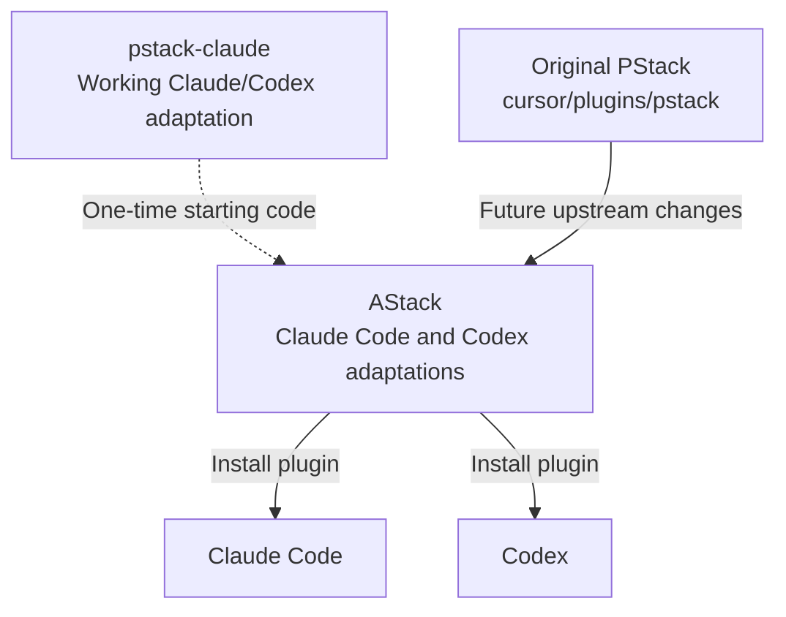
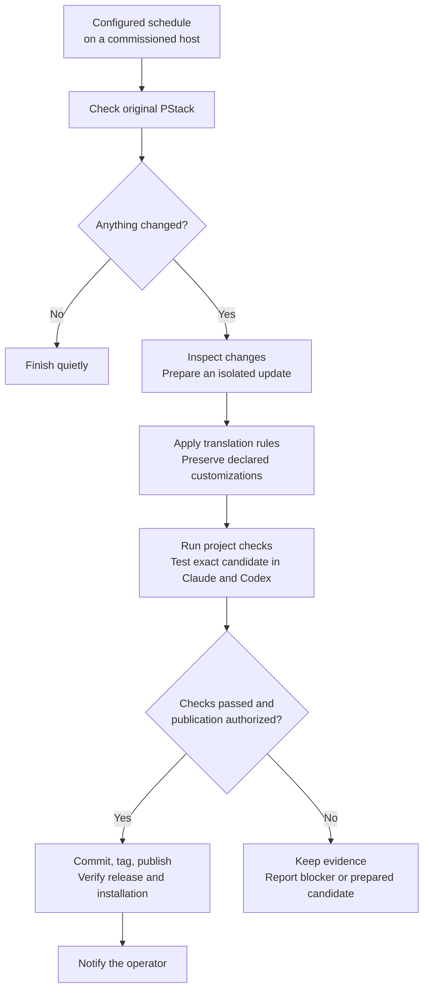
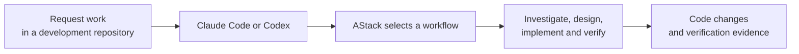

# How AStack fits together

AStack is the plugin used in a development project. A separately configured scheduled agent maintains the plugin repository.

## Source ownership

The bootstrap revision is recorded in `tools/provenance.json`. Future releases follow original PStack directly, using immutable revisions in `tools/upstream.json`. AStack maintains its own translation rules and declared differences. It does not depend on future pstack-claude releases.

## Scheduled maintenance

The schedule invokes an agent, which reads the [committed runbook](maintenance.md). It must stop when a change is ambiguous or a required check fails. Its host must have both authenticated runtimes available to validate a release. A check-only schedule needs fewer capabilities.

The optional GitHub pipeline separates preparation, runtime validation, and publication into jobs with different permissions. It is an alternative publisher. Only one publisher should be enabled for a repository.

## Everyday development

In Claude Code, request `/astack:poteto-mode` followed by the task. In Codex, ask to use AStack's `poteto-mode` skill. You can also request a focused skill such as `architect`, `interrogate`, or `bro`.

Plugin use does not require running the maintenance schedule. Publishing a release does not update an existing agent session. Refresh the installed plugin and reload the session using the host's supported installation flow.
